## About

Software Engineer focused on **backend development, AI integration, and security-conscious engineering**. I build multi-tenant platforms, LLM gateways with guardrails and failover, and tools for analyzing threats, and I validate inputs and test failure paths along the way.

<table>
  <tr>
    <td width="33%" valign="top"><b>Backend</b> APIs · PostgreSQL · multi-tenant data · streaming · rate limiting</td>
    <td width="33%" valign="top"><b>AI Integration</b> LLM gateways · MCP servers · workflow and voice automation</td>
    <td width="33%" valign="top"><b>Security</b> PII guardrails · input validation · malware analysis · regression tests</td>
  </tr>
</table>

## Tech Stack

  

<b>Also:</b> MCP · n8n · Retell · SQLite · ClamAV · YARA · WinForms

## Featured Projects

<table>
  <tr>
    <td width="50%" valign="top">
      <h3>BookedIQ CRM</h3>
        
      A multi-tenant AI automation platform for business workflows: CRM data, automated workflows, and AI voice agents.  
      <code>Next.js</code> <code>TypeScript</code> <code>PostgreSQL</code> <code>Supabase</code> <code>n8n</code> <code>Retell</code>
    </td>
    <td width="50%" valign="top">
      <h3><a href="https://github.com/jev7776/quilrai-ai-gateway-assessment">QuilrAI AI Gateway</a></h3>
        
      An AI security assessment covering an MCP server, a security gateway, streaming PII redaction, token-based rate limiting, and LLM provider failover, with security regression tests.  
      <code>TypeScript</code> <code>MCP</code> <code>PII Guardrails</code> <code>LLM Failover</code> <code>Security Testing</code>
    </td>
  </tr>
  <tr>
    <td width="50%" valign="top">
      <h3><a href="https://github.com/jev7776/jobscout-copilot">JobScout AI</a></h3>
        
      A Python prototype for collecting job listings and tracking applications.  
      <code>Python</code> <code>Automation</code>
    </td>
    <td width="50%" valign="top">
      <h3><a href="https://github.com/jev7776/stable-pay-link">Stable Pay Link</a></h3>
        
      An MVP payment router that picks a payment rail based on speed, cost, and risk, with fallback routing. It uses only the minimum signals needed (privacy-first). This is a demo with UI logic only and does no real payment processing.  
      <code>TypeScript</code> <code>Payments</code> <code>Privacy-First</code>
    </td>
  </tr>
  <tr>
    <td width="50%" valign="top">
      <h3>Offline Malware Analysis Sandbox</h3>
        
      An isolated Linux environment for scanning and classifying suspicious files offline with signature-based and rule-based detection.  
      <code>Python</code> <code>ClamAV</code> <code>YARA</code> <code>Linux</code>
    </td>
    <td width="50%" valign="top">
      <h3>Repair Shop Management System</h3>
        
      A backend application for managing repair shop operations. It is currently in development.  
      <code>Java</code> <code>Spring Boot</code> <code>PostgreSQL</code>
    </td>
  </tr>
  <tr>
    <td colspan="2" valign="top">
      <h3>Boolean Function Compression Explorer</h3>
        
      A desktop research tool for exploring ways to compress Boolean functions.  
      <code>C#</code> <code>WinForms</code> <code>Research</code>
    </td>
  </tr>
</table>

<b>Open to Software Engineering roles in backend, AI integration, and security.</b>

